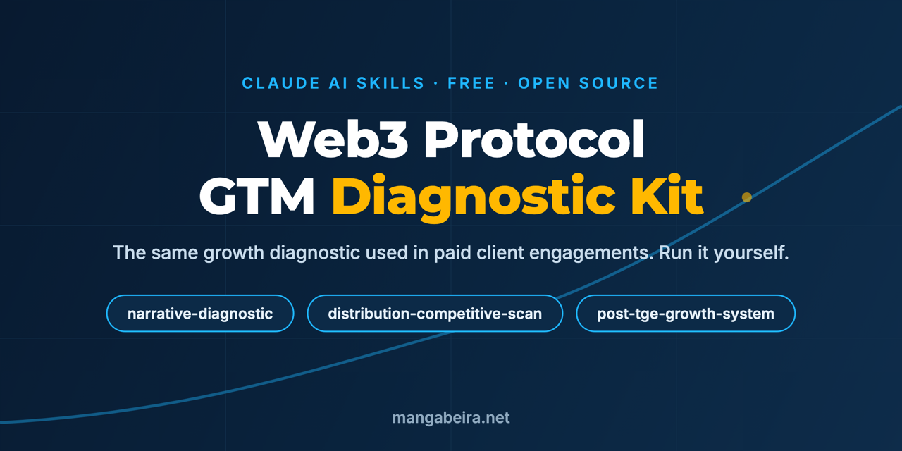

# web3-protocol-gtm-skills

   

**Three Claude AI skills that run the same Web3 GTM diagnostic I apply in paid client engagements, on your own protocol, free.**

Most Web3 protocols don't have a marketing problem. They have a diagnosis problem: channels exist, numbers are moving, and nobody can say which specific thing is holding growth back. These three skills walk Claude through the same structured diagnostic methodology I use with paying clients — narrative, distribution, and the post-launch growth system — and force evidence-backed findings instead of generic advice.

Built by [Gabriel Mangabeira](https://mangabeira.net). Ex-growth at Binance LATAM. The methodology is the same 6-pillar framework behind the [Web3 Growth Audit](https://mangabeira.net/services/web3-growth-audit).

## The Kit

| Skill | What it diagnoses | Status |
|---|---|---|
| [**narrative-diagnostic**](narrative-diagnostic/SKILL.md) | Whether your positioning actually lands: one-sentence test, ICP clarity, differentiation, proof, message consistency | Shipped |
| [**distribution-competitive-scan**](distribution-competitive-scan/SKILL.md) | How your channels stack up against 2-3 direct competitors: engagement rate benchmark, content mix, owned audience, system-vs-islands | Shipped |
| [**post-tge-growth-system**](post-tge-growth-system/SKILL.md) | Why growth stalled after token launch: market-beta check, funnel leak map, activation loops, attribution stack | Shipped |

Each skill produces a structured, scored output with ✅/⚠/❌ status markers, Critical/High/Medium severity flags, and quoted evidence for every claim. No invented numbers, no "post more consistently."

## Install

**Claude Code** (personal skills, available in every project):

```bash
git clone https://github.com/gogrowth-co/web3-protocol-gtm-skills.git
cp -r web3-protocol-gtm-skills/narrative-diagnostic \
      web3-protocol-gtm-skills/distribution-competitive-scan \
      web3-protocol-gtm-skills/post-tge-growth-system \
      ~/.claude/skills/
```

For a single project instead, copy the three folders into that repo's `.claude/skills/` directory.

**Any other Claude interface** (claude.ai, API): open the skill's `SKILL.md`, paste its contents into your conversation, and add your protocol's details. The skills are plain markdown — no dependencies, no build step.

## Use

Once installed, just ask:

```
Run the narrative diagnostic on [protocol] — homepage is [url], X is [@handle]
```
```
Compare our distribution against [competitor A] and [competitor B]
```
```
We launched [token] 2 months ago and TVL is bleeding. Run the post-TGE growth system audit.
```

Each skill tells Claude exactly what inputs to collect, how to score what it finds, and what output format to produce.

## Which skill first?

- Traffic or followers but weak conversion → **narrative-diagnostic**
- A competitor is visibly out-growing you → **distribution-competitive-scan**
- Token is live and the chart is bleeding → **post-tge-growth-system** (it starts with a market-beta check, so you don't spend a quarter fixing marketing when the whole sector is down)

## What this kit can't see

The skills run on public surfaces and the numbers you bring. They don't include on-chain cohort queries (Dune), scraped competitor social intelligence, SEO/AEO analysis, or a prioritized 90-day roadmap. That's the full [Web3 Growth Audit](https://mangabeira.net/services/web3-growth-audit): all six pillars, on-chain data included, fixed scope and price, fully async — no calls.

## License

MIT (see [`LICENSE`](LICENSE)). Use it, fork it, run it on client work. Attribution appreciated, not required.
